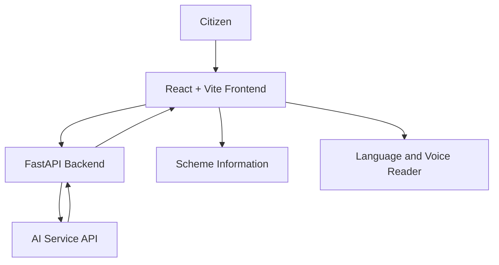

# CivicSaathi AI

CivicSaathi AI is an AI-powered application designed to help citizens discover government welfare schemes and understand their eligibility, benefits, and application procedures.

## Features

- Search for government schemes.
- View available scheme details and eligibility criteria.
- Understand benefits, documents, and application steps when information is available.
- Multilingual support and voice reading, where implemented.
- AI-powered assistance for understanding scheme information.

## Technology Stack

- **Frontend:** React, Vite, JavaScript
- **Backend:** Python, FastAPI
- **AI Integration:** Configured AI service API
- **Package Management:** npm and pip

## Project Architecture



The frontend provides the user interface. The FastAPI backend handles requests and communicates with the configured AI service. The frontend displays the returned information to the user.

## Project Structure

```text
civicsaathi-ai/
├── backend/
│   ├── app.py
│   ├── requirements.txt
│   └── .env.example
├── frontend/
│   ├── src/
│   ├── package.json
│   └── index.html
├── .gitignore
└── README.md
```

## Requirements

- Python 3.12
- Node.js and npm
- Git
- An API key for the configured AI service, if required

## Installation and Setup

### 1. Clone the repository

```bash
git clone https://github.com/Sreenidhi-47/civicsaathi-ai.git
cd civicsaathi-ai
```

### 2. Set up the backend

Open a terminal in the project root:

```powershell
cd backend
py -3.12 -m venv .venv
.\.venv\Scripts\Activate.ps1
pip install -r requirements.txt
```

Create a local `.env` file using `.env.example` as a reference. Add your API key using the exact environment variable name required by the backend code.

Start the backend:

```powershell
uvicorn app:app --reload --port 8000
```

### 3. Set up the frontend

Open a second terminal:

```powershell
cd frontend
npm install
npm run dev
```

Open the local URL printed by Vite, usually `http://localhost:5173`.

Keep the backend running and configure the frontend to use the correct backend URL.

## Security

- Never commit API keys, passwords, or private credentials.
- Keep real environment files out of version control.
- Use placeholder values in `.env.example`.

## Usage

1. Start the backend and frontend.
2. Open the application in your browser.
3. Search for a government scheme.
4. Review the available information and eligibility details.
5. Try the language and voice-reading features if available.

Verify scheme eligibility and application details against official government sources.

## Future Improvements

- Improve scheme search and information retrieval.
- Expand regional-language support.
- Improve multilingual voice reading.
- Provide clearer references to official sources.
